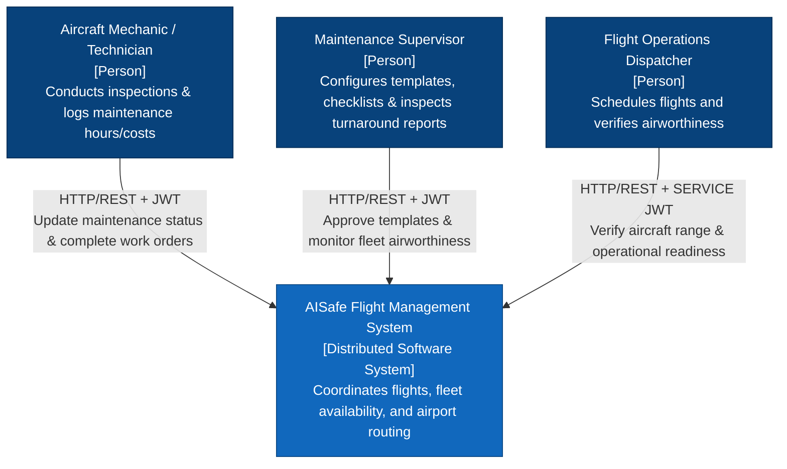
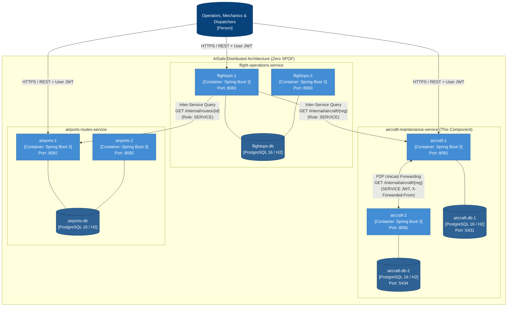
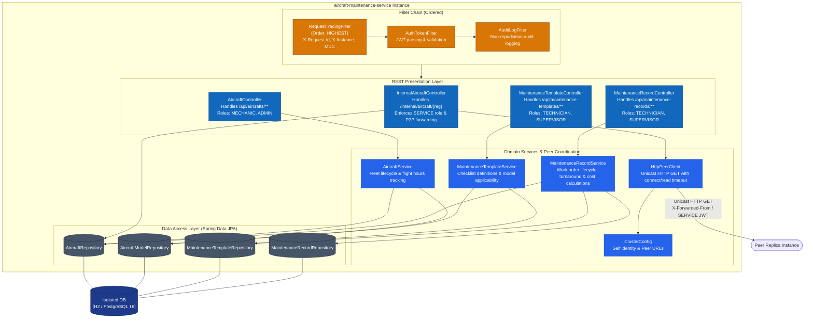
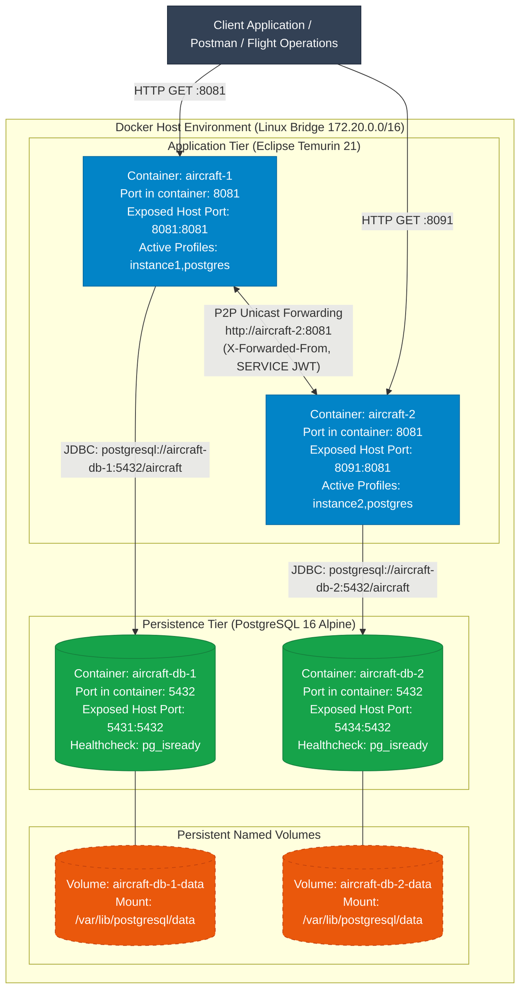
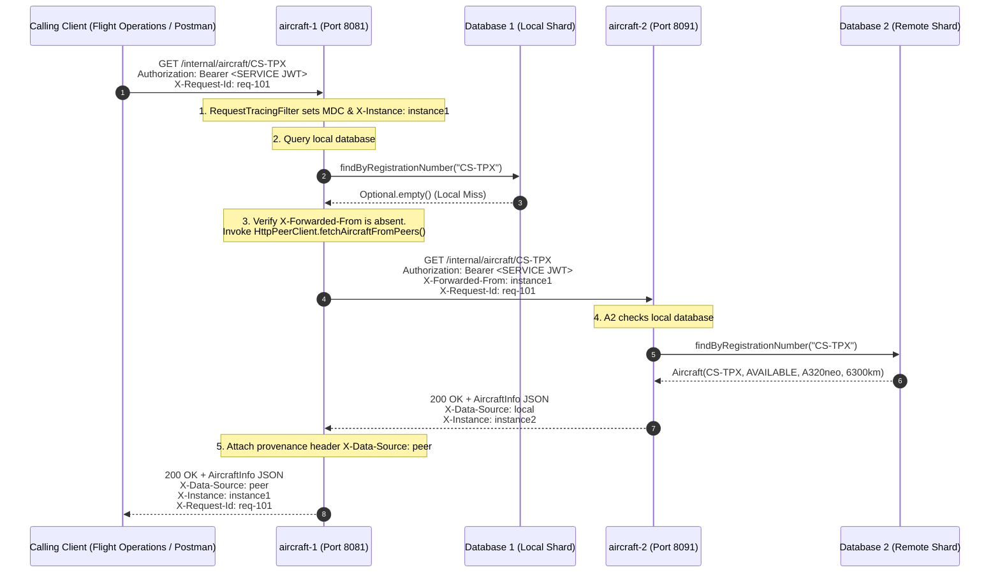
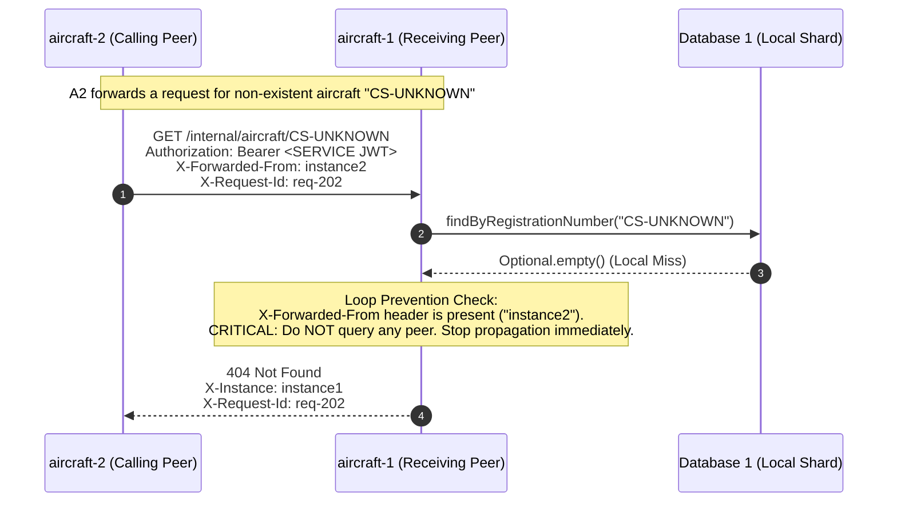

# AISafe Flight Management System - C4+1 Architectural Model
**Component**: `aircraft-maintenance-service`  
**Course**: Sistemas Distribuídos (LETI-SIDIS 2026/27)  
**Author**: André (1240567)  

---

## 1. Introduction & Notation

This document formalizes the architectural design of the **Aircraft & Maintenance Service** using the **C4 model** (Context, Containers, Components, Code) originated by Simon Brown, combined with the dynamic "+1" scenarios of Philippe Kruchten's **4+1 View Model** (IEEE Software, 1995).

---

## Level 1: System Context Diagram

Visualizes the high-level boundaries of the AISafe distributed system, human actors, and the operational responsibilities of the maintenance division.

---

## Level 2: Container Diagram (Domain-Driven Segregation)

Illustrates the decomposition of the original PSOFT monolith into three autonomous, domain-aligned microservices, highlighting active component cloning and isolated databases.

---

## Level 3: Component Diagram (Inside an `aircraft-maintenance-service` Instance)

Details the internal components of a single instance, including the security and distributed tracing filter chain, REST controllers, domain services, P2P peer client, and data persistence repositories.

---

## Level 4: Deployment Diagram (Physical & Virtual Container Topology)

Details the physical/virtual deployment architecture within Docker, illustrating listening ports, network aliases, and dedicated storage volumes.

---

## The "+1": Dynamic Distributed Behavior (Sequence Diagrams)

### Scenario 1: P2P Unicast Query Forwarding Across Replicas
Demonstrates how Instance 1 satisfies a query for partition `CS-TPX` (residing natively on Instance 2) while attaching correlation and provenance headers.

---

### Scenario 2: Distributed Loop Prevention (Cutting Cycle Storms)
Proves that recursive or circular forwarding requests are terminated at the first hop ($hop \le 1$).

