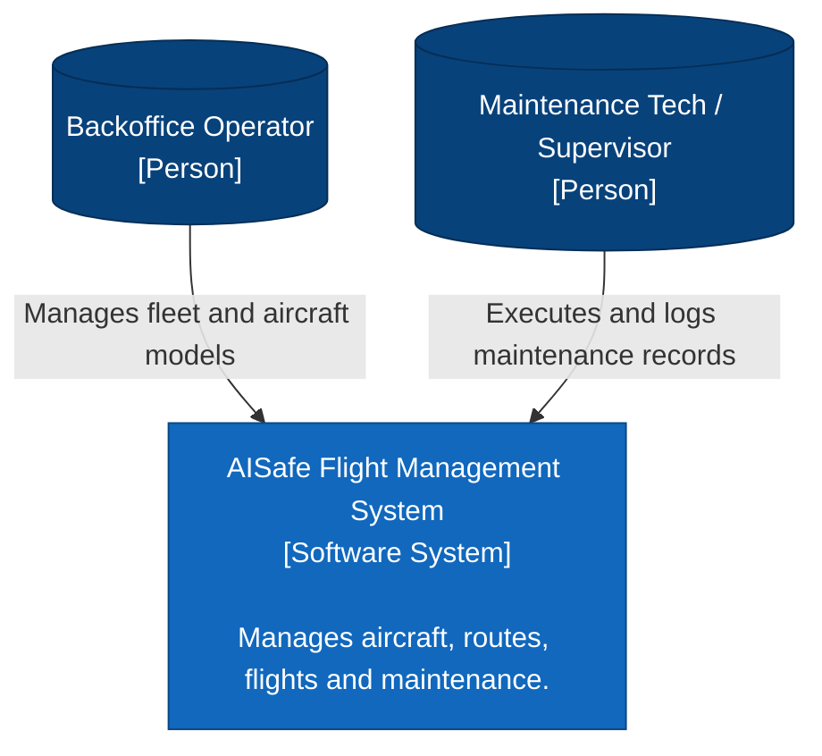
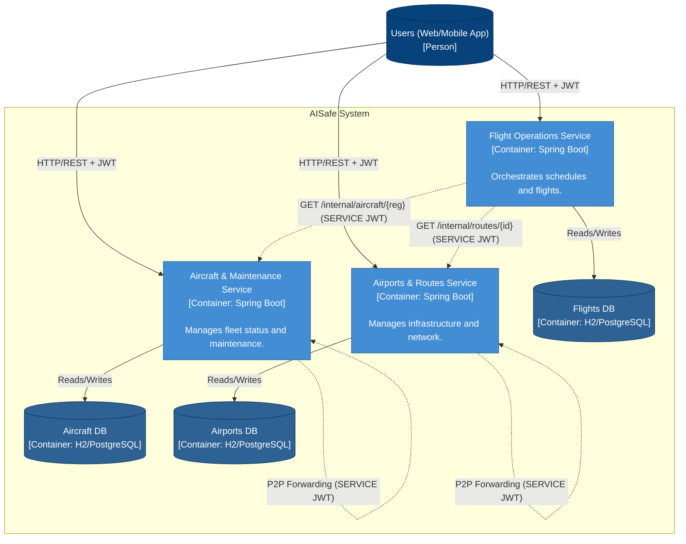
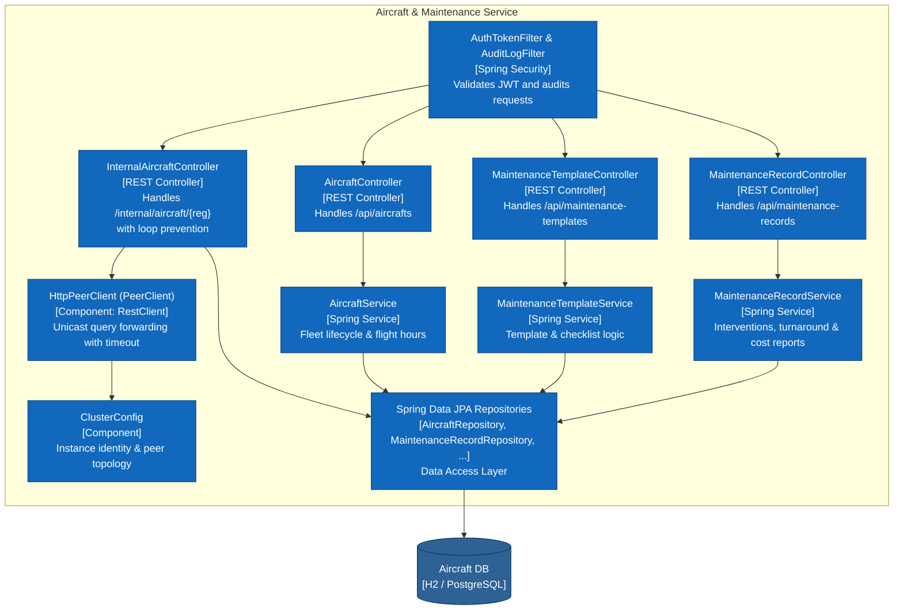
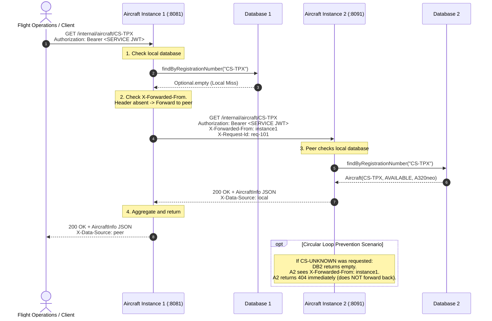

# AISafe Flight Management System - C4 Architecture Model

This document outlines the software architecture of the AISafe distributed system using the C4 model, specifically focusing on the **Aircraft & Maintenance Service**.

## Level 1: System Context
This diagram shows the high-level view of the AISafe system and its users.

## Level 2: Container Diagram
This diagram shows the microservices architecture that makes up the AISafe system, reflecting the Domain-Driven Segregation.

## Level 3: Component Diagram (Aircraft & Maintenance Service)
Focusing specifically on the components inside `aircraft-maintenance-service`.

## The "+1": Dynamic Behavior (Sequence Diagram)
The **C4+1** model combines static architecture with Kruchten's "4+1" dynamic view. This diagram documents the **P2P Query Forwarding with Loop Prevention** (Week 3 Distributed Consistency).

